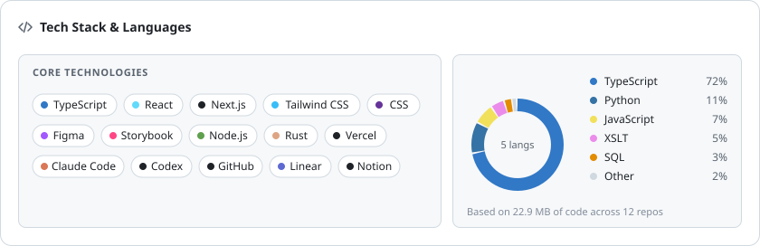

- 👋 Hi, I'm Andrey ([@AndreyLqdn](https://github.com/AndreyLqdn))
- Design engineer, co-founder & CEO at [@weAltura](https://github.com/weAltura)
- Prev: Design Engineer at [Vallora AI](https://app.vallora.dk/login)
- [andreycr.xyz](https://andreycr.xyz) · [LinkedIn](https://www.linkedin.com/in/andreycr/) · [ask me anything](https://andreycr.xyz/ask)

 

<picture>
  <source media="(prefers-color-scheme: dark)" srcset="./stack-dark.svg">
  
</picture>
